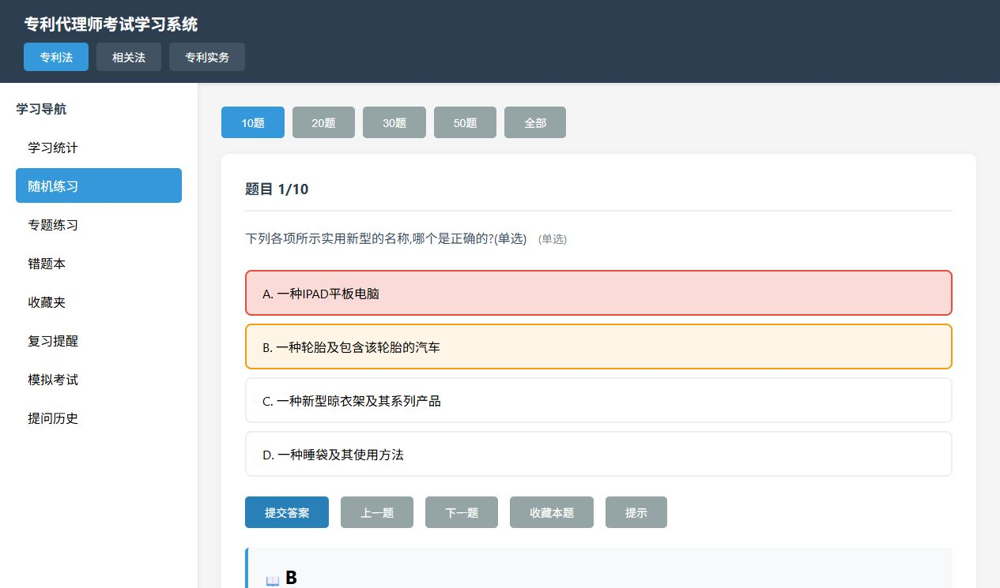

# 专利代理师考试学习系统

这是我准备代理师考试时做的小工具。当时不想再买一个收费题库的会员，就把练题、看解析、记错题这些功能放在一个网页里，也给同事内部用过。

**[打开练习系统](https://orphanwarrior.github.io/test-web/study.html)**

不用注册，学习记录存在当前浏览器里。



*在本地练习时截的图，用的是项目自带题库。*

## 打开以后怎么用

点“随机练习”选题量，答完提交就能看答案和解析。做错的题会进错题本，想留着再看的可以收藏。学习统计里能看答题数量、正确率和最近的练习情况，也可以按已有专题来练。

目前真正有题的只有前三个专利法专题，分别是 26、24、26 题，共 76 题。页面里虽然列了 30 个专题，后面的题库和另外两个科目还没补齐，点进去可能没有题。

## 为什么先做成这样

我当时主要想方便自己练题，就用 HTML、CSS 和 JavaScript 做成静态网页，题目放在 JSON 文件里，部署到 GitHub Pages。开发时用了 AI 编程辅助。

错题、收藏和统计存在 localStorage 里，不需要账号和服务器。不过换浏览器、换设备就不会带过去，清除浏览器数据也会丢。这是目前这个做法的不足。

答题时显示的是题库里已有的解析，不会现场问大模型。“提问笔记”里放的是我在外部 AI 工具中整理问题的办法，网页本身没有接入聊天，也不会保存对话。

复习提醒和模拟考试还没做，页面上的入口只是先留着。题库是个人整理的，内容还需要继续核对和更新。

## 本地打开

```bash
git clone https://github.com/orphanwarrior/test-web.git
cd test-web
python -m http.server 8000
```

然后访问[本地练习页面](http://localhost:8000/study.html)。这里启动的是文件服务，让网页能读取题库，不需要再搭后端。

## 文件放在哪

```text
study.html                  # 页面、样式和练题逻辑
处理后数据/专题1-题库.json    # 26 题
处理后数据/专题2-题库.json    # 24 题
处理后数据/专题3-题库.json    # 26 题
提问.md                     # 在外部工具整理问题的办法
添加题目.md                 # 整理题库时用的说明
```

另一个一直在改的项目是 [TTC 专利撰写工作台](https://github.com/orphanwarrior/028-ttc-showcase)，里面放了这两个月的设计和试验记录。
